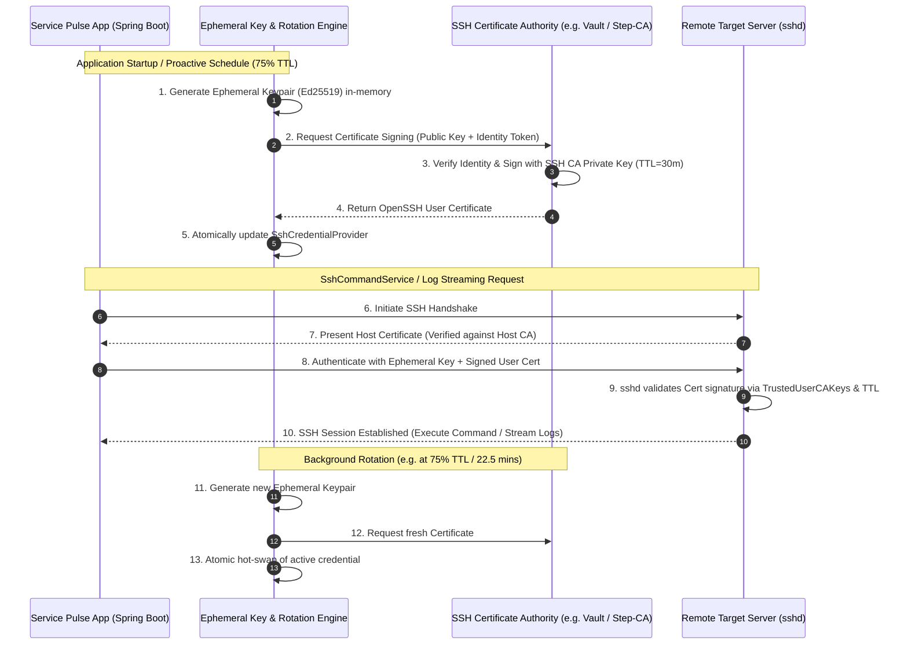

# [EPIC] Keyless SSH Authentication with Ephemeral Rotating Keys and OpenSSH Certificates

## 1. Executive Summary & Improved Feature Description

### Problem Statement
Currently, `Service Pulse App` relies on a static, long-lived SSH private key on disk (`ssh.privateKeyPath`) loaded by `SshCommandService`. This approach presents critical security and operational limitations:
- **Static Credential Exposure Risk:** A static private key stored on the server's filesystem or mounted via container volumes poses a persistent risk of credential theft, unauthorized duplication, and cumbersome incident response.
- **`authorized_keys` Fleet Sprawl:** Every target server must have the static public key pre-installed in `~/.ssh/authorized_keys`. Key rotation requires updating all monitored nodes simultaneously, leading to configuration drift and operational friction.
- **Lack of Time-Bound Access:** Static keys do not expire automatically. Revocation requires manual purging of public keys across the fleet.
- **Permissive Host-Key Checking:** When `known_hosts` is missing, the application falls back to `PromiscuousVerifier`, creating susceptibility to Man-in-the-Middle (MitM) attacks.

### Proposed Solution: Keyless SSH with OpenSSH Certificates
Modernize the SSH infrastructure of `Service Pulse App` by implementing **Keyless SSH Authentication** utilizing **in-memory ephemeral keypairs** and **short-lived OpenSSH user certificates** issued by a centralized SSH Certificate Authority (SSH CA, e.g., HashiCorp Vault SSH Secrets Engine, Smallstep `step-ca`, or internal REST CA):
1. **Zero Disk-Bound Private Keys ("Keyless"):** Generate cryptographic keypairs (Ed25519 / RSA) dynamically in-memory at application startup or on-demand, with zero disk persistence.
2. **Short-Lived Signed Certificates:** The application automatically requests a signed OpenSSH User Certificate from a configured SSH CA. The certificate includes strict principals (e.g., `servicepulse`), cryptographic constraints, and short validity TTLs (e.g., 15–60 minutes).
3. **Target Host CA Trust:** Target servers configure `TrustedUserCAKeys /etc/ssh/ssh_user_ca.pub` once in `/etc/ssh/sshd_config`. Individual `~/.ssh/authorized_keys` entries are no longer required.
4. **Proactive In-Memory Rotation:** An automated background rotation engine generates fresh ephemeral keypairs and requests new certificates before expiration (e.g., at 75% TTL) and atomically swaps credentials without interrupting command execution or log streaming.
5. **Bidirectional Certificate Trust (Host CA):** Support OpenSSH Host Certificates (`@cert-authority` in `known_hosts`) for strict, automated host verification across dynamic fleet servers without manual known_hosts maintenance.
6. **Enterprise Auditability & Observability:** Expose certificate expiration metrics, rotation health indicators via Spring Boot Actuator, and structured security audit logs recording certificate serial numbers and key IDs.

---

## 2. Architecture & Authentication Flow

---

## 3. Tracked Sub-Issues & Implementation Breakdown

| Issue | Title | Scope |
|:---|:---|:---|
| **#17** | **[[Sub-Issue 1/7] SshCredentialProvider Abstraction & Configuration Schema](https://github.com/rsp777/service-pulse-app/issues/17)** | Define `SshCredentialProvider` SPI, extend `SshProperties`, maintain backwards compatibility for static key auth. |
| **#18** | **[[Sub-Issue 2/7] Ephemeral In-Memory Keypair Generation & Zeroization Lifecycle](https://github.com/rsp777/service-pulse-app/issues/18)** | In-memory Ed25519/RSA keypair generation, OpenSSH wire-format serialization, memory wipe on disposal. |
| **#19** | **[[Sub-Issue 3/7] SSH Certificate Authority (CA) Client Integration](https://github.com/rsp777/service-pulse-app/issues/19)** | Client integration for HashiCorp Vault / REST SSH CA, OpenSSH certificate parser and loader into `sshj`. |
| **#20** | **[[Sub-Issue 4/7] Proactive Ephemeral Key & Certificate Rotation Engine](https://github.com/rsp777/service-pulse-app/issues/20)** | Background scheduled rotation engine, TTL monitoring, atomic credential hot-swapping, graceful failure handling. |
| **#21** | **[[Sub-Issue 5/7] SSH Host Certificate Verification & Strict Host-Key Policy](https://github.com/rsp777/service-pulse-app/issues/21)** | Enforce strict host-key verification via Host CA (`@cert-authority`), eliminating `PromiscuousVerifier` in production. |
| **#22** | **[[Sub-Issue 6/7] Actuator Health Indicator, Metrics & Structured Audit Logging](https://github.com/rsp777/service-pulse-app/issues/22)** | Spring Boot Actuator health check, Micrometer metrics for certificate TTL/rotation, and audit logs with serial numbers. |
| **#23** | **[[Sub-Issue 7/7] End-to-End Testcontainers Integration Suite with OpenSSH Server & Mock CA](https://github.com/rsp777/service-pulse-app/issues/23)** | Testcontainers suite with real OpenSSH daemon configured with `TrustedUserCAKeys`, validating rotation and command execution. |

### Sub-Issues Task List
- [ ] #17 `[Sub-Issue 1/7] SshCredentialProvider Abstraction & Configuration Schema`
- [ ] #18 `[Sub-Issue 2/7] Ephemeral In-Memory Keypair Generation & Zeroization Lifecycle`
- [ ] #19 `[Sub-Issue 3/7] SSH Certificate Authority (CA) Client Integration`
- [ ] #20 `[Sub-Issue 4/7] Proactive Ephemeral Key & Certificate Rotation Engine`
- [ ] #21 `[Sub-Issue 5/7] SSH Host Certificate Verification & Strict Host-Key Policy`
- [ ] #22 `[Sub-Issue 6/7] Actuator Health Indicator, Metrics & Structured Audit Logging`
- [ ] #23 `[Sub-Issue 7/7] End-to-End Testcontainers Integration Suite with OpenSSH Server & Mock CA`

---

## 4. Sub-Issues & Detailed Implementation Tasks

### Sub-Issue 1 (#17): SshCredentialProvider Abstraction & Configuration Schema
- **Objective:** Decouple `SshCommandService` from static file loading by introducing a pluggable `SshCredentialProvider` SPI. Extend `SshProperties` to support multiple authentication modes (`STATIC`, `CA_CERTIFICATE`), maintaining 100% backwards compatibility for existing deployments.
- **Key Deliverables:**
  - `com.pawar.todo.amt.ssh.auth.SshCredentialProvider` interface with `getKeyProvider(SSHClient client)` and `getMetadata()`.
  - `StaticKeyCredentialProvider` preserving legacy disk-based private key loading.
  - Extended `SshProperties` with `ssh.auth-mode` (`STATIC`, `CA_CERTIFICATE`) and `ssh.ca.*` configuration block.
- **Files Affected:**
  - `src/main/java/com/pawar/todo/amt/ssh/SshProperties.java`
  - `src/main/java/com/pawar/todo/amt/ssh/SshCommandService.java`
  - `src/main/java/com/pawar/todo/amt/ssh/auth/SshCredentialProvider.java`
  - `src/main/java/com/pawar/todo/amt/ssh/auth/StaticKeyCredentialProvider.java`
- **Acceptance Criteria:**
  - [ ] `SshCredentialProvider` SPI is injected into `SshCommandService`.
  - [ ] Default `ssh.auth-mode=STATIC` behaves identically to existing implementation.
  - [ ] Configuration validation rejects invalid or incomplete configurations on startup.

---

### Sub-Issue 2: Ephemeral In-Memory Keypair Generation & Zeroization Lifecycle
- **Objective:** Implement secure in-memory generation of cryptographic keypairs (Ed25519 and RSA) for "Keyless" SSH authentication. Ensure that no private key material is ever persisted to disk, and sensitive key material is securely zeroized in memory upon key rotation or disposal.
- **Key Deliverables:**
  - `com.pawar.todo.amt.ssh.key.EphemeralKeyPairGenerator` supporting `ED25519` (native Java 17 `KeyPairGenerator`) and `RSA`.
  - `EphemeralKeyPair` holding `KeyPair` references with byte zeroization on `close()`.
  - `OpenSshKeyEncoder` serializing public keys to RFC 4253 OpenSSH wire format (`ssh-ed25519 AAAA...`).
  - Redaction in all `toString()` implementations to prevent accidental secret leakage in logs.
- **Files Affected:**
  - `src/main/java/com/pawar/todo/amt/ssh/key/EphemeralKeyPairGenerator.java`
  - `src/main/java/com/pawar/todo/amt/ssh/key/DefaultEphemeralKeyPairGenerator.java`
  - `src/main/java/com/pawar/todo/amt/ssh/key/EphemeralKeyPair.java`
  - `src/main/java/com/pawar/todo/amt/ssh/key/OpenSshKeyEncoder.java`
- **Acceptance Criteria:**
  - [ ] Generates Ed25519 and RSA keypairs entirely in memory without file system writes.
  - [ ] Generated public keys accurately conform to OpenSSH wire format.
  - [ ] Sensitive byte buffers are zeroized when `close()` is invoked.

---

### Sub-Issue 3: SSH Certificate Authority (CA) Client Integration
- **Objective:** Implement client communication with SSH Certificate Authorities (supporting HashiCorp Vault SSH Secrets Engine, Smallstep `step-ca`, and generic REST CAs) to request and sign short-lived OpenSSH User Certificates. Provide parser and adapter classes to load signed certificates into `sshj`.
- **Key Deliverables:**
  - `com.pawar.todo.amt.ssh.ca.SshCertificateAuthorityClient` interface.
  - `VaultSshCertificateAuthorityClient` invoking Vault's `/v1/{mount}/sign/{role}` endpoint using Spring `RestClient`.
  - `OpenSshCertificateParser` parsing binary certificate headers, validity window (`validAfter`/`validBefore`), principals, and serial numbers.
  - `CertificateKeyProvider` adapting `EphemeralKeyPair` + `OpenSshCertificate` into `net.schmizz.sshj.userauth.keyprovider.KeyProvider`.
- **Files Affected:**
  - `src/main/java/com/pawar/todo/amt/ssh/ca/SshCertificateAuthorityClient.java`
  - `src/main/java/com/pawar/todo/amt/ssh/ca/vault/VaultSshCertificateAuthorityClient.java`
  - `src/main/java/com/pawar/todo/amt/ssh/cert/OpenSshCertificate.java`
  - `src/main/java/com/pawar/todo/amt/ssh/cert/OpenSshCertificateParser.java`
  - `src/main/java/com/pawar/todo/amt/ssh/cert/CertificateKeyProvider.java`
- **Acceptance Criteria:**
  - [ ] Successfully requests and parses OpenSSH User Certificates from Vault / REST CA.
  - [ ] `CertificateKeyProvider` negotiates certificate-based public key authentication in `sshj`.
  - [ ] Network failures and error responses produce typed `SshCaException` without logging auth tokens.

---

### Sub-Issue 4: Proactive Ephemeral Key & Certificate Rotation Engine
- **Objective:** Implement an automated, proactive background rotation engine that monitors the active certificate's TTL, generates fresh ephemeral keypairs, requests new certificates before expiry, and atomically swaps credentials in memory without disrupting running commands or log streams.
- **Key Deliverables:**
  - `ActiveSshCredential` holding active `EphemeralKeyPair` and `OpenSshCertificate`.
  - `CaCertificateCredentialProvider` with lock-free atomic hot-swapping using `AtomicReference<ActiveSshCredential>`.
  - `SshCertificateRotationEngine` implementing `SmartLifecycle` with proactive scheduling (default: rotate at 75% of TTL).
  - Retry logic with exponential backoff on CA failure, and deferred zeroization of superseded keys.
- **Files Affected:**
  - `src/main/java/com/pawar/todo/amt/ssh/rotation/ActiveSshCredential.java`
  - `src/main/java/com/pawar/todo/amt/ssh/rotation/SshCertificateRotationEngine.java`
  - `src/main/java/com/pawar/todo/amt/ssh/auth/CaCertificateCredentialProvider.java`
- **Acceptance Criteria:**
  - [ ] Ephemeral key and certificate rotate proactively before expiration without user intervention.
  - [ ] Credential hot-swap is atomic and non-blocking for concurrent SSH invocations.
  - [ ] Long-running log streams and in-flight commands continue without interruption during rotation.

---

### Sub-Issue 5: SSH Host Certificate Verification & Strict Host-Key Policy
- **Objective:** Implement SSH Host Certificate verification by trusting an SSH Host CA (`@cert-authority` entries or custom `HostKeyVerifier`), enabling zero-friction strict host-key verification across dynamically provisioned target servers and eliminating unsafe fallbacks to `PromiscuousVerifier`.
- **Key Deliverables:**
  - `com.pawar.todo.amt.ssh.verifier.HostCertificateVerifier` validating target server host certificates against the Host CA.
  - Refactored `configureHostKeyVerifier` in `SshCommandService` to enforce strict verification when `strictHostKeyChecking=true`.
  - Restriction of `PromiscuousVerifier` strictly to dev/test profiles with explicit warnings.
- **Files Affected:**
  - `src/main/java/com/pawar/todo/amt/ssh/SshProperties.java`
  - `src/main/java/com/pawar/todo/amt/ssh/SshCommandService.java`
  - `src/main/java/com/pawar/todo/amt/ssh/verifier/HostCertificateVerifier.java`
- **Acceptance Criteria:**
  - [ ] Remote servers presenting valid host certificates signed by the Host CA are verified without per-server `known_hosts` entries.
  - [ ] Unverified host keys are rejected immediately when strict checking is enabled.
  - [ ] `PromiscuousVerifier` is blocked in production environments.

---

### Sub-Issue 6: Actuator Health Indicator, Metrics & Structured Audit Logging
- **Objective:** Provide production-grade observability into the ephemeral key and SSH certificate lifecycle via Spring Boot Actuator health indicators, Micrometer Prometheus metrics, and structured security audit logging recording certificate metadata without exposing secrets.
- **Key Deliverables:**
  - `SshCertificateHealthIndicator` reporting `UP`, `OUT_OF_SERVICE`, or `DOWN` with non-sensitive metadata (serial number, remaining seconds, rotation count).
  - Micrometer metrics: `ssh.cert.ttl.seconds` (Gauge), `ssh.cert.rotations.total` (Counter), `ssh.ca.sign.duration` (Timer).
  - `SshSecurityAuditLogger` emitting structured audit entries containing serial numbers, key IDs, host, and user for each execution.
- **Files Affected:**
  - `src/main/java/com/pawar/todo/amt/ssh/actuator/SshCertificateHealthIndicator.java`
  - `src/main/java/com/pawar/todo/amt/ssh/actuator/SshMetricsBinder.java`
  - `src/main/java/com/pawar/todo/amt/ssh/audit/SshSecurityAuditLogger.java`
- **Acceptance Criteria:**
  - [ ] `/actuator/health` accurately reflects certificate validity and time-to-expiry.
  - [ ] Prometheus metrics endpoint exposes certificate gauges and rotation counters.
  - [ ] Audit logs record certificate serial numbers without logging private keys or tokens.

---

### Sub-Issue 7: End-to-End Testcontainers Integration Suite with OpenSSH Server & Mock CA
- **Objective:** Implement a comprehensive automated integration test suite using Testcontainers that launches a real OpenSSH daemon configured exclusively with `TrustedUserCAKeys`. Validate certificate-based authentication, command execution, log streaming, and mid-flight key rotation without relying on static `authorized_keys`.
- **Key Deliverables:**
  - `OpenSshCaContainer` running OpenSSH server configured with `TrustedUserCAKeys /etc/ssh/user_ca.pub` and `AuthorizedKeysFile none`.
  - `TestSshCertificateAuthority` generating test CA keypairs and signing user/host certificates for test runs.
  - Integration test verifying successful keyless execution, rejection of untrusted/expired certs, and seamless rotation during active streaming.
- **Files Affected:**
  - `pom.xml` (Testcontainers dependencies)
  - `src/test/java/com/pawar/todo/amt/ssh/it/OpenSshCaContainer.java`
  - `src/test/java/com/pawar/todo/amt/ssh/it/TestSshCertificateAuthority.java`
  - `src/test/java/com/pawar/todo/amt/ssh/it/KeylessSshIntegrationTest.java`
- **Acceptance Criteria:**
  - [ ] Integration test suite executes against real OpenSSH daemon with zero entries in `authorized_keys`.
  - [ ] Expired or untrusted certificates fail closed.
  - [ ] Mid-flight rotation test demonstrates active sessions remain uninterrupted while new sessions pick up the new certificate.

---

## 4. Overall Epic Acceptance Checklist

- [ ] `SshCommandService` can authenticate and execute remote commands using an OpenSSH User Certificate signed by a CA.
- [ ] No private keys or certificates are written to the local disk during ephemeral key generation or rotation.
- [ ] Certificates are rotated automatically in the background before expiration without dropping or failing in-flight SSH operations.
- [ ] If CA renewal fails, the system retries with backoff and reports DOWN status in Spring Boot Actuator before certificate expiration.
- [ ] Strict host-key verification is enabled and verifies target servers against a trusted Host CA.
- [ ] Complete Testcontainers integration test verifies end-to-end command execution against a certificate-authenticated OpenSSH server.

---

## 5. Security & Engineering Constraints (per Java Developer workflow)

- **Zero Secret Exposure:** Never log, store on disk, or commit private keys, passphrases, or tokens.
- **In-Memory Hygiene:** Clear byte arrays containing sensitive key material as soon as the keys are loaded or rotated.
- **Strict Host-Key Verification:** Disallow `PromiscuousVerifier` in production environments; rely on Host CA certificates.
- **Backwards Compatibility:** Default configuration must allow existing deployments using static keys (`ssh.auth-mode=STATIC`) to function unchanged.
- **Branching & Commit Standard:** Each task must be delivered on `feature/<issue-number>-<short-kebab-summary>` with commit message `#<issue-number>:<commit-message>`.
