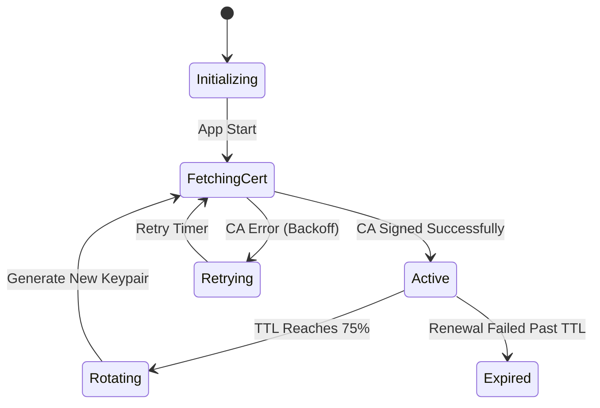

# Sub-Issue 4: Proactive Ephemeral Key & Certificate Rotation Engine

## Parent Epic
Part of Epic #16: [Keyless SSH Authentication with Ephemeral Rotating Keys and OpenSSH Certificates](https://github.com/rsp777/service-pulse-app/issues/16)

## Summary
Implement an automated, proactive background rotation engine that monitors the active SSH certificate's Time-To-Live (TTL), generates fresh ephemeral keypairs, requests new signed certificates before expiry, and atomically swaps credentials in memory without disrupting running commands or long-running log streams.

## Current State & Problem
- Current SSH authentication does not support rotation; keys are static on disk.
- Certificates have strict expiration dates (e.g. 15m - 60m). If an active certificate expires without rotation, all subsequent SSH commands will fail authentication with remote servers.
- Credential replacement must be strictly thread-safe and non-blocking for concurrent threads executing remote commands or streaming logs via `SshCommandService`.

## Proposed Implementation

### 1. ActiveSshCredential Model
Create `com.pawar.todo.amt.ssh.rotation.ActiveSshCredential`:
- Holds `EphemeralKeyPair` and `OpenSshCertificate`.
- Exposes helper methods:
  - `Instant getExpiresAt()`
  - `Duration getRemainingTtl()`
  - `boolean isExpiringSoon(double thresholdPercentage)`
  - `boolean isExpired()`

### 2. CaCertificateCredentialProvider Hot-Swapping
Implement `CaCertificateCredentialProvider` using `AtomicReference<ActiveSshCredential>`:
- Read operations (`getKeyProvider()`) are lock-free and thread-safe.
- Active SSH sessions hold onto the credential reference they checked out during handshake; session continuity is preserved even if rotation occurs mid-flight.
- When new credential is ready:
  1. Atomically swap `AtomicReference`.
  2. Schedule old credential for deferred zeroization/cleanup (e.g., 60-second grace period).

### 3. SshCertificateRotationEngine
Create `com.pawar.todo.amt.ssh.rotation.SshCertificateRotationEngine`:
- Implements `SmartLifecycle` (starts on application startup, cleanly destroys on shutdown).
- Scheduling algorithm:
  - Calculate rotation delay: `delay = max(ttl * (renewThresholdPercent / 100.0), 30 seconds)`.
  - Schedule next rotation using `ThreadPoolTaskScheduler`.
- Resilient Error Handling & Retry:
  - If CA signing fails (e.g., network timeout, CA downtime), immediately retry with exponential backoff (e.g., 10s, 30s, 60s).
  - Emit warnings if remaining TTL falls below 20%.
  - Emit critical error events if certificate expires before renewal succeeds.

## Files Affected
- `src/main/java/com/pawar/todo/amt/ssh/rotation/ActiveSshCredential.java` (new)
- `src/main/java/com/pawar/todo/amt/ssh/rotation/SshCertificateRotationEngine.java` (new)
- `src/main/java/com/pawar/todo/amt/ssh/rotation/RotationEvent.java` (new)
- `src/main/java/com/pawar/todo/amt/ssh/auth/CaCertificateCredentialProvider.java` (new)
- `src/test/java/com/pawar/todo/amt/ssh/rotation/SshCertificateRotationEngineTest.java` (new)
- `src/test/java/com/pawar/todo/amt/ssh/auth/CaCertificateCredentialProviderConcurrentTest.java` (new)

## Acceptance Criteria
- [ ] Ephemeral key and certificate rotate proactively before expiration (default: at 75% of TTL).
- [ ] Credential hot-swap is atomic and non-blocking for concurrent SSH command invocations.
- [ ] In-flight SSH sessions and log streams are not terminated when rotation occurs.
- [ ] Failed CA renewal attempts trigger retries with exponential backoff without crashing the application.
- [ ] Old ephemeral keys are cleanly zeroized after the grace period expires.
